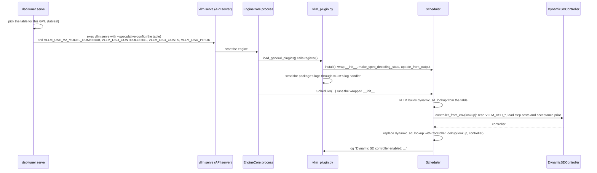
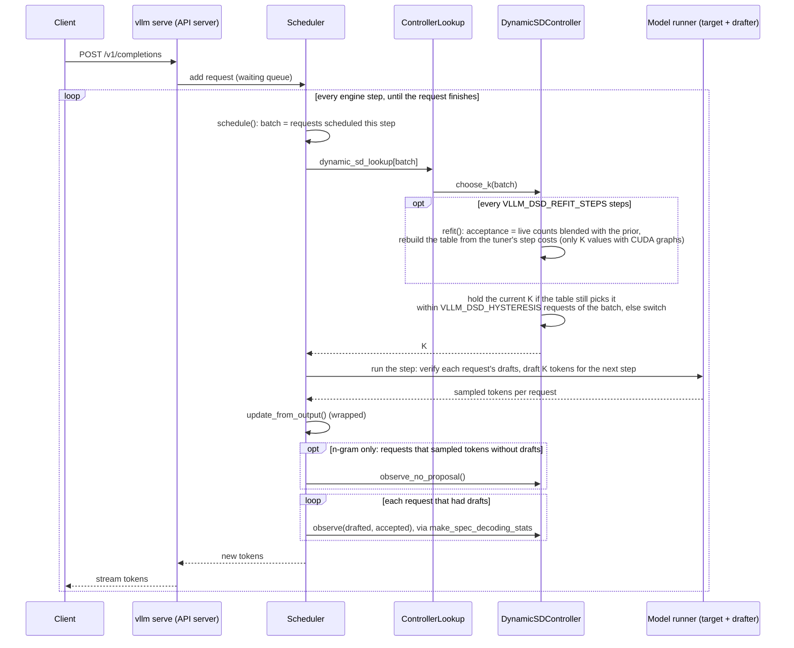

# Controller (in vLLM)

Keeps the table right while serving. Pure Python (`controller.py`), attached to vLLM's scheduler by a plugin (`vllm_plugin.py`) that installs with the package.

- **Hold:** keeps the current K while the batch is only just past a table edge, so K doesn't flip every step.
- **Re-fit:** counts accepted guesses per position on live traffic, blends them with the tuner's acceptance, and every N steps rebuilds the table from the tuner's step costs, using only K values that have CUDA graphs.

## Running it

```bash
dsd-tuner serve
```

`dsd-tuner serve` runs the controller by default, with the tuner's costs and acceptance from the [catalog](../../tables/); `--no-controller` serves the table alone. Either way it also sets `VLLM_USE_V2_MODEL_RUNNER=0`, because Dynamic SD needs vLLM's V1 model runner. With plain `vllm serve`, set `VLLM_USE_V2_MODEL_RUNNER=0` yourself; the plugin is loaded but does nothing until you set `VLLM_DSD_CONTROLLER=1`, `VLLM_DSD_COSTS` and `VLLM_DSD_PRIOR` ([docs/TUNING.md](../../docs/TUNING.md)), so installing the package never changes other vLLM servers on the machine.

## How it attaches to vLLM

Installing this package registers `vllm_plugin.py` under vLLM's `vllm.general_plugins` entry point, which vLLM loads in every process before it builds the scheduler; vLLM's source is not modified. Written against vLLM `353e491ef` (what `install.sh` installs); CI checks that these hook points still exist at that commit.

| What | How |
|---|---|
| Build the controller | wraps `Scheduler.__init__`: after vLLM builds the Dynamic SD lookup, `controller_from_env(...)` |
| Choose K | replaces `scheduler.dynamic_sd_lookup` with a list whose `[batch_size]` returns `controller.choose_k(batch_size)`; its contents stay vLLM's table |
| Observe acceptance | wraps `Scheduler.make_spec_decoding_stats`, which vLLM calls once per request with the drafted and accepted counts |
| Steps without drafts (n-gram only) | wraps `Scheduler.update_from_output` and counts decode steps that sampled tokens without drafts |

`AsyncScheduler` inherits all three. If the controller is enabled and a hook point is missing (another vLLM version), start-up fails with an error rather than running without the controller.

## Sequence

**Startup.** `dsd-tuner serve` sets the environment and replaces itself with `vllm serve`; the engine process loads the plugin before it builds the scheduler.



**A request, and one scheduling step.** Every engine step runs `schedule()`, the GPU step, then `update_from_output()`. The controller is called at three points: once per step to pick K, once per request with drafts to count acceptance, and (n-gram only) for decode steps without drafts.



Nothing here changes which tokens are generated: K only changes how many guesses the model checks per step, and every guess is verified.

## Settings (environment variables)

| Variable | Default | Meaning |
|---|---|---|
| `VLLM_DSD_CONTROLLER` | `0` | `1` enables the controller (`true`/`yes`/`on` also work) |
| `VLLM_DSD_HYSTERESIS` | `4` | Hold K while the batch is within this many requests of a boundary |
| `VLLM_DSD_COSTS` | unset | Glob of the tuner's `costs_k*.json`; with `VLLM_DSD_PRIOR`, enables re-fit |
| `VLLM_DSD_PRIOR` | unset | The tuner's `acceptance.json` (calibrated per-position acceptance) |
| `VLLM_DSD_REFIT_STEPS` | `500` | Re-fit interval, in scheduling steps |
| `VLLM_DSD_PRIOR_WEIGHT` | `2000` | Pseudo-observations behind the prior |
| `VLLM_DSD_DECAY` | `0.5` | Fraction of live evidence forgotten after each re-fit |
| `VLLM_DSD_LOG_STEPS` | `0` | Log controller stats every N steps (0 = off) |

**Experimental** (off by default; added for n-gram):

| Variable | Default | Meaning |
|---|---|---|
| `VLLM_DSD_EXPLORE` | `0` | Every N steps, draft at the deepest allowed K once, if cheap (0 = off) |
| `VLLM_DSD_EXPLORE_MAX_COST` | `0.25` | ... only when that step is at most this much slower than the current K |
| `VLLM_DSD_PRIOR_DECAY` | `0` | The prior's weight shrinks by this factor at each re-fit (0 = off) |
| `VLLM_DSD_ANY_K` | `0` | `1`: re-fits may use any K up to `num_speculative_tokens` (MRv1 only) |

Built-in constraints: only K values present in the starting table are used (the ones with CUDA graphs), never more than `num_speculative_tokens`, and the drafter's K=0 sync forward is never skipped (EAGLE needs it). Changing K never changes the generated tokens.

**Failures:** a bad setting stops vLLM at startup with an error naming the variable: an unparsable or out-of-range value, a missing or malformed file, only one of `VLLM_DSD_COSTS`/`VLLM_DSD_PRIOR`, or costs that don't cover every K in the table. Nothing raises while serving: a failed re-fit is logged and the current table kept; after 3 failures in a row re-fit turns off and the controller keeps hysteresis only.

## Why both a tuner and a controller

| | Tuner (once per GPU + model) | Controller (while serving) |
|---|---|---|
| Step cost per batch size and K | measures it | uses it; can't learn it |
| Which K values exist | picks them | limited to them |
| Acceptance per position | starting guess | learns it live |
| Batch sitting on a table edge | can't help | holds K |

**The tuner measures what the hardware fixes; the controller tracks what the traffic changes.** Without the tuner's step costs the controller can only hold K; with wrong costs (profiled at the wrong prompt length) it would rebuild a misaligned table.

Results: [the paper](../../docs/paper/paper.pdf) and [experiments/results/integration](../../experiments/results/integration/README.md). GPU test: [experiments/vllm_integration](../../experiments/vllm_integration/README.md).
