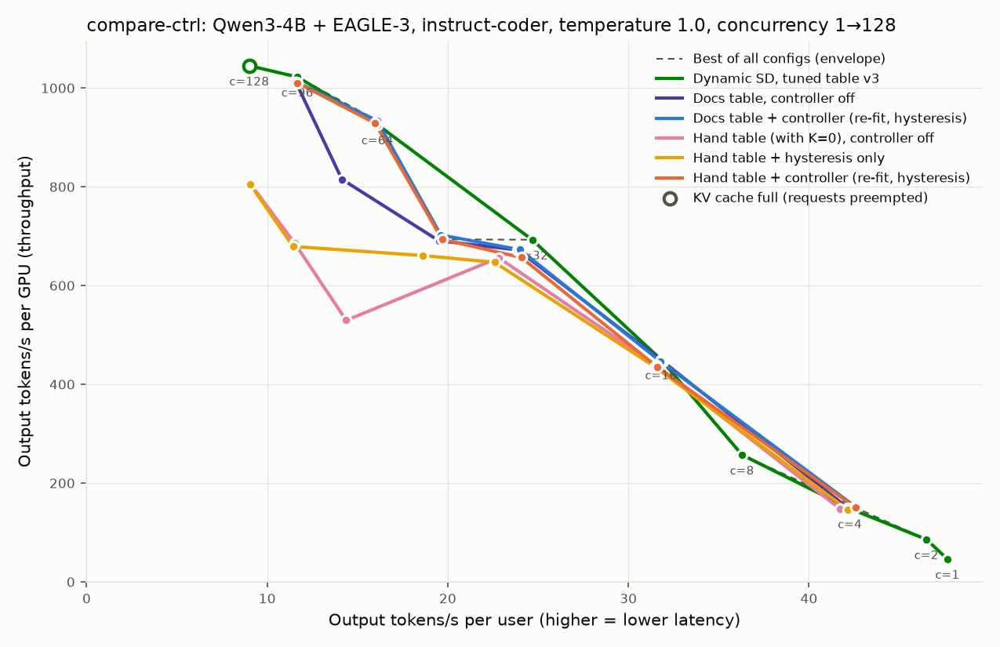

# Integration Test Results (T4)

> Paths and commands here use the package's current name, `dsd_tuning/`; when these runs were made it was `system/` (renamed in 0.0.1).

**Date:** 2026-09-26 · vLLM `353e491ef` + two patches to vLLM (since replaced by the vLLM plugin in `dsd_tuning/controller/`) · Script: [`experiments/vllm_integration/test_gpu.sh`](../../vllm_integration/test_gpu.sh) · **Result: 0 failures.** Section 5 measures the controller's value on misaligned starting tables.

## 1. Unit tests inside vLLM

`57 passed, 1 skipped` ([unit.log](unit.log)): the 18 controller tests copied into vLLM's test tree, vLLM's own Dynamic SD tests, and the scheduler's speculative-decoding tests. The scheduler hooks don't break existing behavior. The skipped test needs this repo's `experiments/results/` folder, which doesn't exist inside vLLM.

Plus the repo's own GPU-free suite: `36 passed` (`uv run --no-project --with pytest python -m pytest -q`).

## 2. Correctness: controller on, greedy outputs vs. no speculation

Offline smoke test (`experiments/bench/smoke_test.py --mode dsd`) with the controller enabled, hysteresis 2 and a re-fit every 20 steps, using the v3 step costs and acceptance as the prior ([summary](smoke_summary.txt)):

- **Greedy outputs matched no speculation token for token: 8/8 batched, 3/3 single.**
- The controller started with allowed K = {0, 1, 3}, the K values in the smoke test's hand table `[[1,4,3],[5,8,1],[9,256,0]]`.
- **Its first re-fit replaced that table** with `[[1,34,3],[35,64,1]]`, built from the stored step costs and the live acceptance (0.603 / 0.339 / 0.158). It dropped the K=0 range and used only K values that have CUDA graphs.
- Throughput on this small workload: 85.4 tok/s vs. 55.4 tok/s for the hand table in the original smoke run ([../smoke/README.md](../smoke/README.md)). A single small run, but it shows the re-fit correcting a poor table while serving.

## 3. Serving: v3 table with and without the controller

Code workload, temperature 1.0, `max_num_seqs=128`, controller with hysteresis 4 and a re-fit every 500 steps ([summary.csv](../sweeps/ctrl-t4/summary.csv)):

| c | v3 table | v3 table + controller | Difference |
|---|---|---|---|
| 4 | 148.3 | 149.6 | +0.9% |
| 32 | 692.8 | 692.4 | 0.0% |
| 64 | 925.7 | 936.9 | +1.2% |
| 96 | 1022.4 | 1015.3 | −0.7% |

Output tokens/s per GPU. The "v3 table" column is from the earlier proof sweep ([../sweeps/README.md](../sweeps/README.md#third-setup-code-at-temperature-10-up-to-128-requests-tuner-v3)).

- **No measurable overhead:** all differences are within ±1.2%, single runs.
- **Hysteresis was active:** 2,000 steps, 8 switches, 25 holds where a plain table lookup would have switched K ([controller log](serving_controller_log.txt)).
- **Re-fits left the table unchanged** (4 re-fits, 0 changes): live acceptance matched the calibrated prior, so the tuner's table was already right. That's the expected behavior when nothing has drifted.
- This run can't show a *gain* from the controller: the table was already tuned for this workload, and the load was steady. A gain needs a misaligned starting table or a live batch hovering at a boundary: see section 5. Workload drift during a single run (e.g. chat, then code) is still untested.

## 4. One-command CLI on the GPU

`python -m dsd_tuning run` on a small grid (K=0–1, batch sizes 1, 8, 16, code prompts at temperature 1.0) ran end to end in 478 s: step costs per K, acceptance, table, and a ready-to-paste `--speculative-config` ([cli-run/](cli-run)). The full-size run is what produced `experiments/results/tuner-v3-code/`.

## 5. Value of the controller (`VLLM_DSD_CONTROLLER=1`)

Section 3 used a table the tuner had already built for this workload, so the controller could only show "no harm". Here it starts from **tables that are misaligned with this GPU and workload**, the situation where it should help. Code workload, temperature 1.0, `max_num_seqs=128`. Re-fit uses the tuner's short-prompt step costs and, as a deliberately wrong prior, the **spec-bench** acceptance, so the controller has to learn code's acceptance from live traffic ([runner](../../bench/run_controller_value.sh)).

| c | Docs table, off | **Docs + controller** | Hand table (with K=0), off | **Hand + hysteresis only** | **Hand + controller** | v3 tuned table |
|---|---|---|---|---|---|---|
| 4 | 149.8 | 152.3 | 147.7 | 146.2 | 150.0 | 148.3 |
| 16 | 446.6 | 445.9 | 438.0 | 435.0 | 434.8 | 450.0 |
| 32 | 672.0 | 672.5 | 656.2 | 647.1 | 656.8 | 692.8 |
| 40 | 690.8 | 702.4 | **529.5** | **660.7 (+24.8%)** | **693.6 (+31.0%)** | n/a |
| 64 | 815.3 | **933.9 (+14.5%)** | 685.7 | 679.2 | **928.9 (+35.5%)** | 925.7 |
| 96 | 1011.5 | 1011.9 | 805.4 | 804.3 | **1010.6 (+25.5%)** | 1022.4 |

Output tokens/s per GPU; percentages vs. the same table with the controller off. Tables: docs example `[[1,64,3],[65,128,1],[129,512,0]]`; hand `[[1,16,3],[17,32,1],[33,64,0]]` (K=0 carried to 128). Controller logs: [docs](../sweeps/ctrlval-refit/controller_log_dsd-docs.txt), [hand](../sweeps/ctrlval-refit/controller_log_dsd-rescaled.txt), [hysteresis only](../sweeps/ctrlval-hyst/controller_log_dsd-rescaled.txt).

**Re-fit fixes a misaligned table while serving.**
- Docs table: K=3 all the way to 64 requests costs 12% at c=64. At its first re-fit (step 200) the controller replaced it with `[[1,34,3],[35,128,1]]`, **+14.5% at c=64**, matching the hand-tuned v3 table (933.9 vs. 925.7).
- Hand table: its K=0 range put it **below no speculation** at c=64–96 (685.7 and 805.4 vs. 703.5 and 830.5). The controller dropped K=0 and built the same `[[1,34,3],[35,128,1]]`: **+25% to +35% at c≥40**, within ~1% of v3 at c=64–96.
- Both runs converged to the same table from completely different starting tables, and learned acceptance from live traffic: prior 0.608/0.328/0.152 (spec-bench) → about 0.62/0.35/0.16 (code, temperature 1.0).

**Hysteresis alone fixes switching at a boundary.** At c=40 the live batch averages ~35, right at the hand table's 32/33 boundary. Without hysteresis K switched among 0, 1 and 3 and throughput collapsed to 529.5, below the table's own result at c=32. With hysteresis only (no re-fit) it ran pure K=1 (acceptance 0.63/0.00/0.00; 576 holds) and recovered **+24.8%**. Away from the boundary it changed nothing (±1.4%), and it can't fix a misaligned table (c=64–96 stay low; that needs re-fit).

**Limits:**
- **K values are restricted to the starting table's set** (CUDA graphs are captured only for those). Neither starting table contains K=2, so the controller couldn't use it: ~3–5% behind v3 at c=32, where K=2 is best. Start with a table that contains every K you want available.
- **The boundary wobbled** between re-fits (34 ↔ 35) as the acceptance estimate moved slightly. Harmless here; could be damped by only replacing the table when the predicted gain exceeds a threshold. Not implemented.
- **Hysteresis holds K on the way up too:** with hysteresis 8, batches just above 16 keep K=3 while the load ramps up (the hysteresis-only run shows some K=3 steps at c=64). No measurable cost here, but it's a side effect of holding.
- Single run per point; differences under ~3% are noise. The gains above (14–35%) are well outside it.

## 6. Regression check after adding n-gram support (issue #3)

The tuner and controller gained a proposal rate for drafters that propose only on some steps (n-gram), plus a fourth scheduler hook for decode steps without drafts. For EAGLE the rate is 1 and the hook is a no-op, so nothing should change. Checked on 2026-09-26 with `CTRL_SWEEP=ctrl-t4-regress bash experiments/vllm_integration/test_gpu.sh`, patches rebuilt from commit 8db667a ([log](test_gpu_regress.log)):

| Check | Result |
|---|---|
| vLLM's `core.py` / `controller.py` equal the repo's | identical |
| Repo tests, incl. `tests/tuner/test_tuner_eagle_regression.py` (the stored v2, v2-code and v3 tables recomputed from their costs and acceptance, goodput values, the controller rebuild from section 5) | 55 passed |
| Unit tests inside vLLM (controller, Dynamic SD, scheduler) | 63 passed, 1 skipped |
| EAGLE-3 + controller, greedy vs. no speculation | 8/8 batched, 3/3 single |
| EAGLE-3: proposal rate tracked? | no (as intended) |
| N-gram + controller, greedy vs. no speculation | 8/8 batched, 3/3 single |
| N-gram: proposal rate tracked? | yes: rebuilt with proposal rate 0.210 |

Serving, v3 table + controller, code workload at temperature 1.0 (tok/s per GPU, single runs):

| c | v3 table, controller off | controller on, before (section 3) | controller on, after | after vs. before |
|---|---|---|---|---|
| 4 | 148.3 | 149.6 | 145.4 | −2.8% |
| 32 | 692.8 | 692.4 | 683.7 | −1.3% |
| 64 | 925.7 | 936.9 | 932.6 | −0.5% |
| 96 | 1022.4 | 1015.3 | 1011.1 | −0.4% |

All within the ~3% single-run noise.

**One difference, not caused by the change.** This run's controller changed the table twice (the earlier run: 0) ([log](serving_controller_log_regress.txt)): at its first re-fit the live acceptance was 0.605 / 0.327 / 0.150, slightly below the calibration (0.605 / 0.339 / 0.158), and the table switched to K=2 at batch sizes 4–5; later re-fits (0.625 / 0.349 / 0.160) switched back to the v3 table. Batch sizes 4–5 are the K=3 cost spike, where K=2 and K=3 are within ~1% (A3), so a 1–3% acceptance change flips them. The pre-change `core.py` (commit 05e5982) builds exactly the same two tables from those two estimates, so this is sampling variation in live traffic at temperature 1.0, not the code. It is the "boundary wobble" limit noted in section 5; a minimum-gain threshold for table changes would damp it.

**N-gram line above is a mechanism check only:** the rebuild used EAGLE's step costs (`tuner-v3-code`); n-gram needs its own cost profile (issue #3).

## 7. Exploration and prior decay (issue #2)

Two opt-in controller options, off by default: `VLLM_DSD_EXPLORE=20` (every 20 steps, draft at the deepest allowed K for one step if the cost model says it is at most `VLLM_DSD_EXPLORE_MAX_COST=0.25` slower) and `VLLM_DSD_PRIOR_DECAY=0.5` (the prior's weight halves at every re-fit, down to 1%). Motivation: n-gram run (b), where a wrong prior (EAGLE's) left positions 4–5 stuck at the prior and learning was slow ([../ngram-tuner/README.md §5](../ngram-tuner/README.md#5-controller)). Runs: `bash experiments/scripts/run_ctrl_fix.sh` on 2026-09-26, patches from commit 0117ec4 ([log](ctrl_fix.log)).

**Simulation first** (`tests/controller/test_controller.py::test_run_b_ratchet_and_its_fix`, real n-gram costs, true acceptance 0.79 / 0.71 / 0.66 / 0.62 / 0.59, p = 0.49): options off reproduces run (b)'s table `[[1,2,5],[3,128,3]]`; exploration alone or decay alone does not fix it; both together rebuild the tuner's `[[1,20,5],[21,128,3]]`. A 10% cost cap never allowed exploring on n-gram (K=5 costs 13–16% more than K=3 at 4–8 requests), hence 25%: the average slowdown is bounded by 25% / 20 = 1.25%.

**A. N-gram, untuned table, EAGLE's prior, options on** (compare run b, options off):

| Estimate | Run (b), off | A, on | True |
|---|---|---|---|
| Acceptance, positions 1–3 | 0.69 / 0.50 / 0.38 | 0.84 / 0.77 / 0.72 | 0.79 / 0.71 / 0.66 |
| Acceptance, positions 4–5 | 0.074 / 0.034 (never moved) | up to 0.36 / 0.32, back to 0.18 / 0.13 | 0.62 / 0.59 |
| Proposal rate | 0.71 | 0.55–0.58 | 0.49–0.52 |
| Table | `[[1,2,5],[3,128,3]]` | alternates `[[1,2,5],[3,128,3]]` and `[[1,2,5],[3,4,3],[5,~8,5],[~9,128,3]]` (18 changes, 124 explored steps) | `[[1,20,5],[21,128,3]]` |

Throughput equals run (a) with the calibrated prior (132.8 / 296.2 / 506.3 / 689.3 / 709.9 / 758.1 tok/s at c = 4..128). Prior decay fixed positions 1–3 and the proposal rate. Positions 4–5 are unstuck but not learned: exploring is only allowed at small batches (here c=4 and 16), most steps are at 32–128 requests, and the live counts are halved at every re-fit even when no new data arrived, so the estimate relaxes back toward the prior. The simulation cycled back to small batches more often and did not show this.

**B. N-gram, tuned v2 table, calibrated prior, options on** (compare run d, options off):

| c | 4 | 16 | 32 | 64 | 96 | 128 |
|---|---|---|---|---|---|---|
| Options on (B) | 158.1 | 300.5 | 510.8 | 693.7 | 720.7 | 758.8 |
| Options off (d) | 145.9 | 300.0 | 505.7 | 688.3 | 722.7 | 755.2 |
| B vs. d | +8.4% | +0.2% | +1.0% | +0.8% | −0.3% | +0.5% |

No measurable throughput cost (13 explored steps). The estimates for positions 4–5 fell to 0.48 / 0.44 and then 0.34 / 0.29, and the table changed 7 times (run d: 0), shrinking the K=5 range from 1–20 to ~1–10 requests. *Correction (item A below): this is not a counting bias.* vLLM's counters give 0.62 / 0.59 at positions 4–5 only from 64 requests up; at 1–16 requests (the first 16–64 prompts of the shuffled set) they measure 0.47–0.58. With prior decay on, the estimate follows those small, early samples, and the tuned table sits near a K=3/K=5 tie at 10–20 requests, so it flips.

**Item A: is the controller counting right?** (`VLLM_DSD_DEBUG=1`, n-gram tuned v2 table, calibrated prior, options off, c = 4 and 16; sweep `ngram-ctrl-debug`.) *Note (2026-09-30): `VLLM_DSD_DEBUG` was removed later (commit 116a906, PR #42) and today's controller ignores it. There is no direct replacement: `VLLM_DSD_LOG_STEPS` logs step, switch and re-fit counts, and each table change logs the acceptance estimate. To rerun this item, use a commit before 116a906.* The controller's undecayed totals match vLLM's counters from the same server:

| Positions 1–5 | Acceptance |
|---|---|
| Controller, cumulative (2,502 drafts, all of length 5) | 0.775 / 0.668 / 0.605 / 0.563 / 0.527 |
| vLLM counters, c=4 / c=16 | 0.77 / 0.64 / 0.55 / 0.50 / 0.47 · 0.76 / 0.67 / 0.62 / 0.58 / 0.54 |
| vLLM counters, fixed K=5 sweep, c = 1, 2, 4 (the same first 16 prompts) | position 4: 0.53, 0.55, 0.51 |
| vLLM counters, fixed K=5 sweep, c = 96, 128 (384–512 prompts) | 0.80 / 0.71 / 0.66 / 0.62 / 0.59 |

No counting bug: acceptance at the deep positions depends on which prompts are in flight, and small low-load samples are less copy-heavy than the calibration set. The remaining problem is stability: the table flips when a K=3/K=5 tie meets noisy small-sample estimates (next: a minimum predicted gain before replacing the table).

**C. EAGLE-3, untuned tables, spec-bench prior, options on** (compare section 5, options off):

| Start table | Rebuilt table | Estimates | Throughput vs. options off |
|---|---|---|---|
| Docs example | `[[1,34,3],[35,128,1]]` (as before) | 0.63 / 0.35 / 0.16 | −4.3% (c=4) .. +0.8% |
| Docs table ÷4 (K=0 above 32) | `[[1,34,3],[35,128,1]]` (as before) | 0.62 / 0.35 / 0.16 | −0.4% .. +2.6% |

EAGLE is unchanged: the same tables, the same estimates, throughput within noise. There was almost nothing to explore (0–2 steps): the tables already use EAGLE's deepest K=3 at small batches.

**Item B: any K on MRv1** (`VLLM_DSD_ANY_K=1`, honoured only with `VLLM_USE_V2_MODEL_RUNNER=0`; MRv1's PIECEWISE graphs are keyed by token count, not by K). Runs: `bash experiments/scripts/run_ctrl_items.sh` ([log](ctrl_items.log)).

- *Correctness:* greedy smoke with the controller re-fitting every 20 steps and any K: EAGLE-3 8/8 batched, 3/3 single; n-gram 8/8, 3/3. From the smoke table `[[1,4,3],[5,8,1],[9,256,0]]` (no K=2) the EAGLE controller rebuilt `[[1,18,3],[19,43,2],[44,64,1]]`: the v3 table, K=2 included, and vLLM ran K=2 without it being in the startup table.
- *Value:* EAGLE-3 docs table (K in {1,3}) + controller, spec-bench prior, code workload at T=1.0 (sweep `ctrlval-anyk`). It rebuilt exactly the tuner's v3 table `[[1,18,3],[19,43,2],[44,128,1]]` (later adding K=2 at 4–5 requests, the known tie):

| c | Controller, table's Ks only (§5) | **Controller, any K** | v3 table, controller off | Docs table, controller off |
|---|---|---|---|---|
| 16 | 445.9 | 447.7 | 450.0 | 446.6 |
| 32 | 672.5 | **697.3 (+3.7%)** | 692.8 | 672.0 |
| 40 | 702.4 | **786.1 (+11.9%)** | n/a | 690.8 |
| 64 | 933.9 | 935.2 | 925.7 | 815.3 |

The 3–5% gap at c=32 is closed (697.3 vs. 692.8 for the v3 table). At c=40 the live batch (~35) sat on the K=3/K=1 boundary with the table's Ks; with K=2 available it gains 12%. Single runs.

**Item A, stability: minimum gain and decay-seen-only** (`VLLM_DSD_MIN_GAIN=0.02`, `VLLM_DSD_DECAY_SEEN_ONLY=1`, on top of exploration and prior decay; run B's setup; sweep `ngram-ctrl-stable`, [log](ctrl_stable.log)). *Note (2026-09-30): both options were removed later because they did not stop the flips on the GPU (commit 116a906, PR #42); nothing replaced them, and today's controller ignores both variables. To rerun this item, use a commit before 116a906.* In simulation (5 seeds, acceptance lower at low load as measured) the 2% minimum gain cut table changes from 2–5 to 0. **On the GPU it did not:** 6 changes (run B: 7), throughput the same as run B at every load (158.3 / 299.8 / 512.9 / 693.7 / 722.1 / 756.2 tok/s; −0.1% to +8.5% vs. run d).

The estimate for positions 4–5 moved far, not a little: 0.47 / 0.43 down to 0.31 / 0.25, below even the low-load vLLM counters (0.47–0.58), so the predicted gain of K=3 at 11–19 requests was well above 2%. The likely reason is *which requests get sampled*: K=5 is used only below ~19 running requests, and at c = 32–128 batches that small occur only at the end of each load level, when the few requests left are the longest ones, which appear to copy less at deep positions. The simulation drew acceptance independently of the request and could not show this. The flips stay at 11–19 requests and cost no throughput; a real fix needs a confidence rule (e.g. enough samples, from more than one load level, before live data may move a position), which is a larger design change.

**Decision: all options stay off by default.** Prior decay is useful and cheap. Exploration costs nothing measurable, but the n-gram table changes more often with it (item A: the counting is right; a minimum-gain rule fixed the flips in simulation but not on the GPU, where deep positions are only sampled from the long requests left at the end of each load level; no throughput cost). Any K on MRv1 is correct for both drafters and closes the missing-K gap (item B); it stays opt-in because it relies on the runner being pinned to MRv1. None changes EAGLE's default behaviour.

## A harness bug found along the way

The first attempt reported **−40% for the controller**. That was wrong: a vLLM engine process (`VLLM::EngineCore`) from an earlier, killed server survived and kept the GPU and port 8000, so the new server couldn't start and the benchmark talked to the old one. The correctness test couldn't even allocate GPU memory. Fixes, now in the scripts:

- `experiments/bench/run_configs.sh` stops the engine-core process too and waits until the GPU is actually free.
- `experiments/bench/launch_server.sh` refuses to start if the port answers or the GPU already has processes.
- `experiments/vllm_integration/test_gpu.sh` checks the GPU is free before starting.

After the fix, the rerun above shows no difference (−0.7% to +1.2%).
