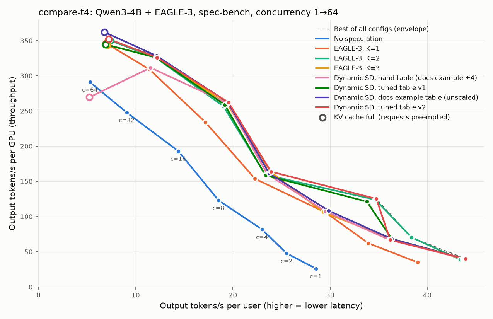
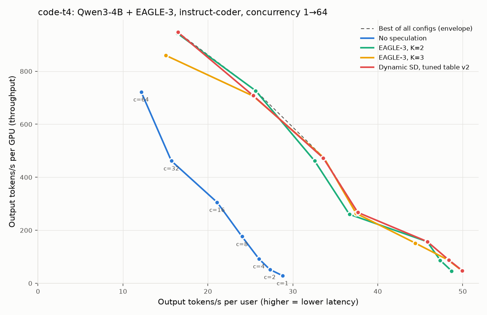
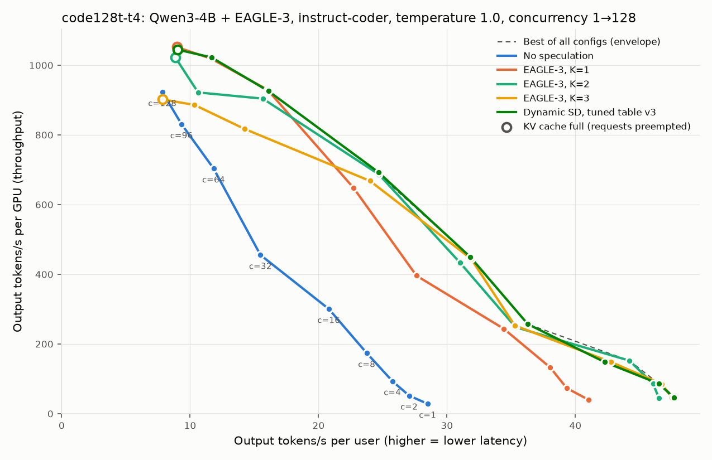

# T4 Results: Baseline, Tuner, and Dynamic SD Comparison

> Paths and commands here use the package's current name, `dsd_tuning/`; when these runs were made it was `system/` (renamed in 0.0.1).

**Date:** 2026-09-25 · **Hardware:** AWS g4dn.xlarge (Tesla T4 16 GB) · **vLLM:** `353e491ef`, MRv1 · **Model:** Qwen3-4B (FP16) + EAGLE-3 drafter `AngelSlim/Qwen3-4B_eagle3` · **Workload:** spec-bench via aiperf, greedy, thinking off, responses capped at 256 tokens

The T4 is the development GPU. It checks that the method works end to end; the final comparison runs on a larger GPU (see [Limitations](#limitations)).

> **Note (2026-09-30):** this README was written at the start of the project. The T4 later became one of the two results GPUs, with 3-run repeats ([`../repeats/`](../repeats/README.md), issue #10), next to an A10G of similar size; see the [top-level README](../../../README.md). The plans below that say otherwise are kept as written.



## Headline

**On the T4, tuned table v2 matches the best fixed K at every concurrency except c=2, and ties the vLLM docs example table except for a repeatable +15% at c=4.** On a second workload (code), where no fixed K is best everywhere, the same table matches or beats the better fixed K at 6 of 7 concurrencies and beats K=3 by 10.2% at c=64, but only by 0.1–2.7% over the better fixed K, so the advantage is modest ([details](#second-workload-code-instruct-coder)). **With short code prompts at temperature 1.0 and up to 128 requests, the advantage is clear:** every fixed K loses 10–15% somewhere, while tuned table v3 never loses more than 2.5% ([details](#third-setup-code-at-temperature-10-up-to-128-requests-tuner-v3)). The T4's memory cap (64 concurrent requests) stops before the load where speculation stops paying off, so there is little for a schedule to decide. The tuner finds the right K, but a static K=3 table is almost as good on this GPU.

| c | No spec | Best fixed K | Docs example table (unscaled) | Hand table (docs ÷4, mine) | Tuned v1 | **Tuned v2** | v2 vs. best fixed | v2 vs. docs | v2 vs. v1 |
|---|---|---|---|---|---|---|---|---|---|
| 1 | 26.0 | 39.8 (K=3) | 40.0 | 39.9 | 40.0 | **40.0** | +0.5% | +0.2% | +0.2% |
| 2 | 47.6 | 70.4 (K=2) | 68.3 | 67.2 | 68.2 | **66.9** | −5.0% | −2.1% | −2.0% |
| 4 | 81.7 | 124.0 (K=2) | 108.3 | 107.4 | 121.2 | **125.1** | +0.9% | **+15.5%** | +3.2% |
| 8 | 123.0 | 163.2 (K=3) | 161.5 | 160.5 | 158.6 | **163.9** | +0.4% | +1.5% | +3.3% |
| 16 | 193.0 | 260.0 (K=3) | 262.3 | 260.8 | 259.0 | **262.4** | +0.9% | 0.0% | +1.3% |
| 32 | 247.8 | 326.2 (K=3) | 328.4 | 311.6 | 326.1 | **326.1** | −0.0% | −0.7% | 0.0% |
| 64 | 291.1 | 350.3 (K=2) | **362.2** | 269.6 ⚠️ | 344.5 | **352.3** | +0.6% | −2.7% | +2.2% |

Output tokens/s per GPU. c = client concurrency. "Best fixed K" is the best of the three fixed-K sweeps (K=1/2/3) at that concurrency. Tables: v1 `[[1,2,3],[3,42,2],[43,64,1]]`, v2 `[[1,2,3],[3,5,2],[6,32,3],[33,64,2]]`.

- **v2 vs. best fixed K:** within 1% at 6 of 7 concurrencies. At c=2, v2 picks K=3 (its table says K=3 for B≤2, and the live batch at c=2 averaged 1.8), while fixed K=2 measured best; the gap to fixed K=3 at the same point is 2%, so this is a near-tie plus noise.
- **v2 vs. the docs example table, used unchanged:** a tie (±2.7%) except **+15.5% at c=4**. With `max_num_seqs=64`, only the docs table's first range (`[1, 64] → K=3`) is ever used, so it behaves like K=3 everywhere. The c=4 gain is repeatable: four separate K=3 runs landed at 106–108 tok/s, while K=2 runs get 121–125. It comes from a real cost spike for K=3 at B=3–5 on this GPU (see [How the tuner works](#how-the-tuner-works)). The c=64 difference is within that point's run-to-run noise (see [Uncertainties](#uncertainties-and-open-questions)).
- **v2 vs. v1:** +2–3% at c=4, 8 and 64 after the fixes below. v1's monotone rule forced K=2 where K=3 was better (c=8–32) and K=1 where K=2 was better (c=64).
- **Tuned vs. the hand table:** +27.8% at c=64 (v1), but **that table is my own rescaling of the docs example** (every boundary divided by 4 to fit 64 requests). It isn't a table anyone published. It shows how a hand-written table with a boundary *inside* the operating range can fail (finding 3), not that the tuner beats the docs.
- **K ran as intended:** position-3 acceptance is about 0.01 at c=4 and c=64 (K=2 ranges) and about 0.14 at c=8–32 (K=3 range), so the live batch mostly stayed inside one range per concurrency.

## How the tuner works

**In plain terms:** measure step time, measure acceptance, apply one formula, get a table.

| Step | Script | What it does |
|---|---|---|
| 1 | `profile_costs.py` | Measures **how long one decode step takes** for each batch size and K (once per GPU + model + drafter) |
| 2 | `profile_acceptance.py` | Measures **how many draft tokens get accepted** on the workload's prompts (per workload, ~2 min) |
| 3 | `make_schedule.py` | Applies one formula, **tokens per second = batch size × tokens per step ÷ step time**, and picks the K with the highest value for each batch size. That gives the table. |

There is no separate model or learned component: "the goodput formula" below is just step 3's formula applied to the two measurements.

[`dsd_tuning/`](../../../dsd_tuning). v2 takes about 70 minutes of GPU time (v1: 25), mostly the denser batch grid.

1. **Step cost T(B, K)** ([`profile_costs.py`](../../../dsd_tuning/tuner/profile_costs.py)). For each K ∈ {0,1,2,3}, time decode steps at **every B from 1 to 16, then every 4 up to 64**, through the *Dynamic SD code path* (table pinned to K), so the PIECEWISE CUDA graphs and the K=0 drafter sync forward are part of the cost. **Synthetic zero acceptance** makes every step emit exactly one token per request, so the batch stays at exactly B while the drafter and verifier still do their full K work. Prompts are 320 tokens (the longest that fits 64 requests in the KV cache without preemption). Repeats agree within 1%, and across processes within 0.3%.
2. **Acceptance** ([`profile_acceptance.py`](../../../dsd_tuning/tuner/profile_acceptance.py)). Per-position acceptance at K=3 on **all 160 spec-bench prompts the sweeps never sent** (the sweeps used 320 of 480, taken from aiperf's per-request records): 0.608 / 0.328 / 0.152 → tokens per step 1.61 / 1.94 / 2.09 for K=1/2/3. The live sweeps saw about 0.61 / 0.34 / 0.155.
3. **Schedule** ([`make_schedule.py`](../../../dsd_tuning/tuner/make_schedule.py)). `K*(B) = argmax B·AL(K)/T(B,K)`, then two rules to limit switching:
   - **Ties keep the current K:** going from B−1 to B, K changes only if another K is more than 0.5% better.
   - **Narrow ranges are merged:** a range must span at least 25% of its starting B, otherwise it takes the neighbouring K that loses the least goodput.

   Raw argmax: `[[1,2,3],[3,5,2],[6,19,3],[20,20,2],[21,32,3],[33,43,2],[44,48,3],[49,64,2]]` (7 boundaries). After the rules: **`[[1,2,3],[3,5,2],[6,32,3],[33,64,2]]`** (3 boundaries).

**The best K on the T4 goes up and down with batch size.** The K=3 → 2 → 3 → 2 pattern comes from a cost spike, not noise: the third draft token adds 12–18% to a step at B=3–5 but only 3–5% at B=2 and B≥6 (v2 dense grid). The benchmark confirms it (K=3 at c=4 ≈ 107 tok/s in four runs vs. ≈ 124 for K=2). nsys traces ([`experiments/results/nsys/`](../nsys)) show two causes: at B=5, K=3 pushes the main model past 16 tokens per step (20), where cuBLAS switches from a 16×16 WMMA GEMM to 64-row-tile kernels (+7–9 ms per step), while K=2 stays at 15; at B=3–4, Triton's attention kernel costs about 33% more with 4 query tokens per request than with 3.

### v1 → v2: what changed and why

| | v1 | v2 | Why |
|---|---|---|---|
| Switching guard | K may never rise with B ("monotone") | Ties keep current K; merge ranges narrower than 25% of start B | The monotone assumption is false on the T4 (spike above). It erased the real K=3 range at B=8–38. |
| Tie-break | Smaller K wins within 2% | Current K wins within 0.5% | "Prefer smaller K" pushed K=3 → 2 wherever they were close. |
| Batch grid | 1, 2, 4, 8, 12, 16, 24, 32, 48, 64 | 1–16, then every 4 | Linear interpolation smeared the one-point spike at B=4 across B=3–9. |
| Calibration | 64 unused prompts | All 160 unused prompts | 64 came out about 2% low, undervaluing deeper K. |
| Prompt length | 256 | 320 | Closer to the workload's context; still no preemption at B=64. |

On the **v1 profiles**, the two rule changes alone already turn the table into `[[1,2,3],[3,7,2],[8,38,3],[39,64,2]]` (6 of 7 concurrencies match the best fixed K). The profiling changes then locate the spike more precisely.

Profiles and tables: [`experiments/results/tuner/`](../tuner) (v1), [`experiments/results/tuner-v2/`](../tuner-v2) (v2).

### Cost: tuner vs. sweep

**The tuner is not cheaper than a sweep on the first run.** GPU time on the T4:

| What | Time | Workload-specific? |
|---|---|---|
| Fixed-K sweep (no-spec + K=1/2/3, 7 concurrency levels) | ~50 min | yes: redo for every new workload |
| Tuner v1: step costs (coarse grid) | ~25 min | no: once per GPU + model + drafter |
| Tuner v2: step costs (dense grid) | ~70 min | no: once per GPU + model + drafter |
| Tuner: acceptance recalibration + new table | **~2 min** | yes: redo for every new workload |

v2's dense grid, needed to catch the B=3–5 spike, makes the first run **longer** than the sweep it replaces. The case for the tuner is different:

1. **Hardware cost and workload are measured separately.** Step time depends only on GPU, model and drafter (profiled with synthetic acceptance), so it is measured once. Only acceptance depends on the workload, and re-measuring it and rebuilding the table takes about 2 minutes, against about 50 minutes to re-sweep. The savings start from the second workload.
2. **It produces a K for every batch size** (1–64), not just the 7 swept concurrency levels. The B=3–5 spike lies between sweep points.
3. **It needs no real traffic,** only synthetic inputs and a small prompt sample.

Not yet tried: making the profile cheaper (fewer repeats, since they agree within 1%; shorter runs; a coarse grid refined only where Ks are close or cost jumps). That might bring the first run back to ~25–30 min while still catching spikes.

#### What recalibration is, and why it's cheaper

The tuner has two inputs, and they change for different reasons:

| Input | Depends on | When to redo it | Time |
|---|---|---|---|
| **Step cost** (how long a step takes for each batch size and K) | GPU, model, drafter | Only when the hardware or model changes | ~70 min, done once |
| **Acceptance** (how often the drafter's guesses are right at each position) | The **kind of text** being generated (chat, code, math…) | For every new workload | **~2 min** |

**Recalibration** means re-measuring only the acceptance on a small sample of prompts from the new workload (160 here), then rebuilding the table from it and the step costs you already have.

It's cheaper because a sweep mixes hardware cost and workload into one measurement: switching to a code workload means re-running the whole ~50-minute sweep. The tuner keeps them separate, so a new workload costs only the ~2-minute acceptance run. The first run costs more, and the savings start from the second workload onward.

**How to recalibrate for a new workload:**

```bash
# 1. Sample prompts from the new workload's dataset (same column aiperf uses)
~/.local/share/uv/tools/aiperf/bin/python dsd_tuning/tuner/sample_prompts.py \
    --dataset likaixin/InstructCoder --column instruction --n 160 \
    --out experiments/results/tuner-v2-code/prompts.jsonl
# 2. Measure acceptance on them (~2 min on the T4)
python dsd_tuning/tuner/profile_acceptance.py --prompts-file experiments/results/tuner-v2-code/prompts.jsonl \
    --out experiments/results/tuner-v2-code/acceptance.json
# 3. Rebuild the table from the existing step costs (seconds, no GPU; this study served at most 64 requests)
python dsd_tuning/tuner/make_schedule.py --costs 'experiments/results/tuner-v2/costs_k*.json' \
    --acceptance experiments/results/tuner-v2-code/acceptance.json --max-num-seqs 64 --out experiments/results/tuner-v2-code
```

Done for the code workload: 98 s for step 2. The rebuilt table differed from the spec-bench one by a single boundary (see [Second workload](#second-workload-code-instruct-coder)).

## Findings

1. **On the T4, speculation never loses to no speculation up to c=64.** Every speculative configuration except the hand table beats no-spec by 18–54%. The expected crossover to K=0 doesn't occur within the concurrency this GPU can hold; only small K=3 ↔ 2 ↔ 1 shifts appear.
2. **Memory runs out before compute does.** EAGLE-3 reduces KV cache capacity by **about 28%** (37.2k → 26–27k tokens: drafter weights plus drafter KV cache). At c=64 every speculative configuration hits 100% KV usage and preempts requests (18–81 preemptions, about 48–53 requests actually running); no-spec peaks at 88% with no preemptions.
3. **A table boundary inside the operating range causes K switching (thrashing).** The hand table says K=0 for 33–64, yet at c=64 positions 2 and 3 still show accepted drafts (0.18 and 0.08). The live batch dips below 33 while new requests are in prefill, flipping K back to 1 or 3. Result: 76 preemptions and 269.6 tok/s, **7% below no speculation**. This matches vLLM issue [#49548](https://github.com/vllm-project/vllm/issues/49548). The tuned tables' boundaries sit mostly outside where the live batch hovers (v1: 43; v2: 5/6 and 32/33), and the per-position counters show them running at the intended K (finding 3's switching appears only when K=0 is involved and the KV cache is full).
4. **Dynamic SD's baseline tax is small on the T4.** K=0 under Dynamic SD costs 36.6 ms/step at B=1 vs. 35.0 ms no-spec inter-token latency (≈5%). Dynamic SD at K=3 (the docs table) matches or beats fixed K=3 at every c. The PIECEWISE override matters less here because the T4 is slow per step, so launch overhead is a small share. Expect a larger tax on faster GPUs ([#49986](https://github.com/vllm-project/vllm/issues/49986)).
5. **Acceptance doesn't depend on load.** Per-position acceptance stays about 0.61 / 0.34 / 0.15 at every concurrency. Only the verification *cost* changes with batch size, which is why a batch-size table plus a one-time acceptance profile is enough.
6. **The goodput formula ranks K well but over-predicts absolute throughput about 2×** at high concurrency (≈820 predicted vs. 347 measured for K=1 at 64). It covers steady-state decode only; the sweep also includes interleaved prefill (about 370 prompt tokens per request), queueing, and preemption.

#### Can the formula predict whether a tuner is worth it?

The same formula can answer a different question before any benchmark: *if you used one fixed K everywhere, how much would you lose compared with the best K at each batch size?* A large loss means a table is worth deploying; a small one means a fixed K is fine. Using the T4 step costs and each workload's measured acceptance (no GPU needed):

| Workload | Best fixed K (K=2): worst predicted loss | Average predicted loss | Measured: worst loss of K=2 vs. tuned table |
|---|---|---|---|
| spec-bench | 4.6% (at B=6) | 0.9% | ~3% |
| code | 5.5% (at B=6) | 1.4% | 2.7% (at c=8) |

- **It predicted "modest" correctly for both workloads**, and it predicted K=3's weak spot (8–9% loss around B=40; K=3 measured −8.9% at c=64 on code).
- **It would not have flagged code as more interesting than spec-bench** (5.5% vs. 4.6%). What made code different in the benchmark was *short prompts* (little prefill, no KV pressure), and the step costs were measured once at a single 320-token prompt length, so the formula can't see prompt length.
- To use it as a cheap filter for choosing which workloads to benchmark, it needs (1) acceptance at the sampling temperature actually used (the profiler decoded greedily when this was written) and (2) step costs at more than one prompt length. *Update (2026-09-30):* acceptance at the served temperature is now supported (`--temperature` in `profile_acceptance.py` and `dsd-tuner run`/`recalibrate`; the v3 table below was calibrated at T=1.0), and step costs can be profiled at the workload's prompt length (`--isl`); step costs at more than one prompt length at once are not.

## Second workload: code (instruct-coder)

Same server, harness and configs, on aiperf's `instruct-coder` dataset (instruction-only prompts from `likaixin/InstructCoder`, so the model writes code from scratch). The tuned table is **v2 as calibrated on spec-bench**. It never saw these prompts.



| c | No spec | K=2 | K=3 | **Tuned v2** | v2 vs. best fixed | v2 vs. K=2 | v2 vs. K=3 |
|---|---|---|---|---|---|---|---|
| 1 | 28.6 | 46.6 | 47.6 | **47.6** | +0.1% | +2.1% | +0.1% |
| 2 | 52.0 | 86.9 | 88.2 | **88.3** | +0.1% | +1.5% | +0.1% |
| 4 | 92.3 | 157.2 | 151.6 | **157.4** | +0.1% | +0.1% | +3.8% |
| 8 | 176.4 | 260.3 | 263.8 | **267.3** | +1.3% | +2.7% | +1.3% |
| 16 | 305.5 | 461.8 | 473.9 | **472.9** | −0.2% | +2.4% | −0.2% |
| 32 | 461.7 | 726.5 | 706.4 | **708.1** | −2.5% | −2.5% | +0.2% |
| 64 | 722.0 | 943.4 | 859.9 | **947.5** | +0.4% | +0.4% | **+10.2%** |

Output tokens/s per GPU. `dsd-docs` was skipped: on this server it behaves exactly like K=3.

**Bottom line: a modest advantage.** The tuned table's gain over the *better* fixed K is small: +0.1% to +2.7% where it wins, −2.5% at c=32, all within a few percent. Its value on code is that **no single fixed K is safe**. K=3 loses 10.2% at c=64 and K=2 loses up to 2.7% at c=8, and you only know which fixed K is right after sweeping. The tuner lands near the better one at every load without that sweep. It is not a large speedup: the big win here is speculation itself (+31–70% over no spec), which any reasonable K captures.

- **On code, no fixed K is best everywhere, and the tuned table comes close to the better one everywhere.** K=3 loses up to 10.2% (c=64); K=2 loses up to 2.7% (c=8). v2 matches or beats the better fixed K at 6 of 7 concurrencies, by small margins. This is the clearest evidence so far for a per-batch-size table, and the advantage is still modest.
- **The first clean, compute-driven change in the best K.** Code prompts are short, so there's almost no prefill, the KV cache never fills (0 preemptions everywhere, ~56 of 64 requests running at c=64), and high concurrency means large decode batches. The third draft token then costs 8.9% at c=64 (K=3 vs. K=2) with no memory effect involved. On spec-bench, high-concurrency results were muddied by preemption.
- **The spec-bench table carried over.** Recalibrating on 160 code prompts (98 s) raised acceptance (0.624/0.363/0.176 vs. 0.608/0.328/0.152) but moved only one table boundary (32→33), so the tuner predicted the spec-bench table would work on code, and it did.
- **The one miss is c=32 (−2.5% vs. K=2).** The live batch averaged 27, inside v2's K=3 range (6–32), while K=2 measured best. The measured switch from K=3 to K=2 lies between c=16 and c=32, a bit lower than the formula's B=33. The goodput formula ignores prefill and queueing, which is the likely cause.
- **Speculation still never loses to no spec** (+31–70%), but its gain drops from +57% at c=32 to +31% at c=64, the steepest decline seen on the T4. The crossover to K=0 is likely just beyond the server's 64-request limit for this workload.
- **Acceptance again doesn't depend on load:** about 0.63/0.36/0.17 at every concurrency.
- **Calibration/benchmark overlap:** calibration prompts were drawn with seed 1234 from 108,391 rows. 1 of the 160 has the same text as one of the 320 prompts the sweep sent (most likely a repeated short instruction). Negligible.

## Third setup: code at temperature 1.0, up to 128 requests (tuner v3)

**This is where the tuner shows a clear advantage on the T4.** Same code workload, but with sampling at temperature 1.0 (how most deployments run) and the server limit raised to 128 requests. Short code prompts (32 tokens on average) leave room in the KV cache for ~115 running requests, so high load is compute-bound for longer.



| c | No spec | K=1 | K=2 | K=3 | **Tuned v3** | v3 vs. best fixed | K v3 ran |
|---|---|---|---|---|---|---|---|
| 1 | 28.3 | 40.2 | 44.7 | 45.9 | **46.0** | +0.3% | 3 |
| 2 | 51.8 | 73.4 | 85.5 | 85.3 | **85.9** | +0.4% | 3 |
| 4 | 93.3 | 132.7 | 152.1 | 148.3 | **148.3** | −2.5% | 3 |
| 8 | 173.8 | 243.7 | 248.2 | 253.1 | **257.0** | +1.5% | 3 |
| 16 | 300.4 | 396.0 | 433.5 | 444.5 | **450.0** | +1.2% | 3 |
| 32 | 455.4 | 648.1 | 686.7 | 668.0 | **692.8** | +0.9% | 2 |
| 64 | 703.5 | 930.0 | 904.1 | 816.9 | **925.7** | −0.5% | 1 |
| 96 | 830.5 | 1018.8 | 922.0 | 886.3 | **1022.4** | +0.4% | 1 |
| 128 | 922.9 | 1052.2 | 1022.7 | 901.9 | **1045.1** | −0.7% | 1 |

Output tokens/s per GPU. "K v3 ran" is read from per-position acceptance (third position ≈0.15 → K=3; ≈0.01 → K=2; second position ≈0 → K=1).

**Worst-case loss against the best measured at each concurrency:**

| | K=1 | K=2 | K=3 | **Tuned v3** |
|---|---|---|---|---|
| Worst loss | 14.6% (low load) | 9.8% (c=96) | 14.3% (high load) | **2.5%** (c=4) |

- **Every fixed K loses 10–15% somewhere; the tuned table never loses more than 2.5%** and is within 1% of the best at 8 of 9 concurrencies. K=1 wastes spare compute at low load; K=3 pays too much verification at high load; K=2 falls behind at c=96. The table `[[1,18,3],[19,43,2],[44,128,1]]` steps K=3 → 2 → 1 as load grows and ran the intended K at every level, with no visible switching.
- **The one miss is c=4 (−2.5%),** the known B=3–5 cost spike. The raw per-batch best did pick K=2 at B=4–5, but the tie rule kept K=3 because the formula saw the gain as under 0.5%; the benchmark measured 2.5%.
- **Speculation still beats no-spec everywhere** (+13% at c=128, +63% at c=1), so the crossover to K=0 remains just past the T4's range. The tuner's value here is choosing *how much* to speculate, not whether to.

**How it was built** ([`experiments/scripts/run_v3_code.sh`](../../scripts/run_v3_code.sh)):

1. **Step costs with 32-token prompts, B=1–128** (~43 min). With v2's 320-token prompts, the formula predicted K=2 best up to 256 requests, but the benchmark showed K=1 winning from c=64. Short prompts make attention much cheaper (K=0 at B=64: 66.8 ms vs. 125 ms), which changes the relative cost of extra draft tokens. With the short-prompt costs the formula switches to K=1 at B=44, between the measured c=32 and c=64 crossover points.
2. **Acceptance on code at temperature 1.0** (98 s): 0.605/0.339/0.158 (greedy: 0.624/0.363/0.176). Sampling barely lowers acceptance for this model and drafter.
3. **Table for 128 requests** (seconds): 8 raw boundaries merged to 2 by the tie and minimum-width rules.

**What this adds to the earlier findings:**

- **Prompt length matters as much as acceptance.** The same GPU, model and drafter need a different table for short prompts than for long ones: step costs must be profiled at the workload's prompt length, not once.
- **Temperature matters little** for this model and drafter (−3% tokens per step at T=1.0), contrary to the expectation that sampling would push speculation toward K=0.
- Single run per point; differences under ~3% are within noise. The worst-case gap between fixed K (10–15%) and the table (2.5%) is well outside it.

## Is this a niche problem?

**Partly, yes.** The unscaled docs example table lands within a few percent of the tuner on the T4, even though it wasn't written for this GPU. That isn't because it's well tuned:

1. **Most of it never activates.** At `max_num_seqs=64` only its first range (`1–64 → K=3`) is used, so on the T4 it is simply "K=3 everywhere". Its K=1 and K=0 ranges were never tested.
2. **On the T4, most reasonable K values are nearly equally good.** K=2 and K=3 are within ~3% of each other almost everywhere (the exception is the B=3–5 spike, +15%). Speculation never stops paying before memory runs out, so any K in 2–3 lands near the best.

So **choosing K precisely (2 vs. 3) is niche**: it gains a few percent, about the size of run-to-run noise, wherever the whole operating range sits in the regime where speculation clearly pays (small to medium batches, latency-focused serving, memory-limited GPUs like the T4).

**The tuner's real job isn't micro-optimizing K.** It is:

1. **Finding the crossover to K=0 for a given GPU and model.** From the Dynamic SD PR's own H100 data ([#32374](https://github.com/vllm-project/vllm/pull/32374)): at batch 256, fixed EAGLE is 23% slower than no speculation (TPOT 19.96 vs. 16.2 ms). A table from another GPU gets this boundary wrong: the H100 table turns speculation off at 166 requests, while the T4 never needed to within 64.
2. **Placing boundaries where they won't cause switching.** The hand table put a boundary where the live batch hovers and dropped 7% below no speculation (finding 3); [#49548](https://github.com/vllm-project/vllm/issues/49548) reports collapses of up to 10×.

**On the T4 there's no crossover, so these experiments could only show the niche part.** Testing the part that matters needs a GPU with enough KV headroom to reach the crossover (A10G/L4/H100).

**Update, code workload:** with short prompts the T4 does enter the compute-bound regime, and there fixed K stops being "good enough": K=3 loses 10.2% at c=64 and K=2 loses up to 2.7% at c=8, while the tuned table matches the better one almost everywhere (see [Second workload](#second-workload-code-instruct-coder)). So whether a static table is enough depends on the workload as well as the GPU.

**Update, code at temperature 1.0 up to 128 requests:** here the best K runs 3 → 2 → 1 across the load range, every fixed K loses 10–15% somewhere, and the tuned table stays within 2.5% of the best everywhere ([Third setup](#third-setup-code-at-temperature-10-up-to-128-requests-tuner-v3)). This is the non-niche case on the T4: not K=0, but a table that has to change K twice.

**A possibly bigger lever the data points to:** EAGLE-3 takes ~28% of the KV cache, and at c=64 every speculative configuration preempted requests (18–81 times). At high load the right decision may be "turn speculation off when KV pressure is high" (a memory signal), not "K=2 vs. K=3" (a compute signal). A KV-pressure-aware policy can be tested on the T4 directly. Not done yet.

## Uncertainties and open questions

These are points the data doesn't settle. They should be stated, not smoothed over.

- **Which GPU and model the docs example table was tuned for is unknown.** The [docs page](https://docs.vllm.ai/en/latest/features/speculative_decoding/dynamic_speculative_decoding/) presents `[[1,64,3],[65,128,1],[129,512,0]]` as an example for Llama-3.1-8B + EAGLE and names no GPU. The only tables with measurements behind them are from the Dynamic SD PR author ([#32374](https://github.com/vllm-project/vllm/pull/32374)), for Llama-3.1-8B on one H100, e.g. `1–64: K=3, 65–101: 2, 102–165: 1, 166–256: 0`. On a 64-request server that is also K=3 everywhere, so it would behave like the docs table here. "Docs table" in this README means *a table written for a different setup, used unchanged*, not "the H100-optimal table".
- **Run-to-run noise at c=64 is about ±5%, and it's driven by preemption.** Two runs that both use K=3 everywhere (fixed K=3 and the docs table through Dynamic SD) gave 343.8 vs. 362.2 tok/s with 48 vs. 18 preemptions. At c=64 the KV cache is at its limit and preemption timing varies between runs. Differences under about 5% there, including the tuned table's −4.9% vs. the docs table, can't be called from one run.
- **The best K at c=64 is within noise.** v1 picked K=1 (344.5), v2 picks K=2 (352.3); fixed runs gave K=1 346.5, K=2 350.3, K=3 343.8, and the docs table (K=3) 362.2. All are within the ±5% preemption-driven noise at this load. The goodput formula doesn't include preemption.
- **The K=3 spike at B=3–5 is explained, partly.** nsys shows a GEMM kernel switch above 16 tokens per step and higher attention cost with 4 query tokens per request ([`experiments/results/nsys/`](../nsys)). Microbenchmarks confirm both in isolation and explain the smaller steps (an attention step at B=10→11 for every K). Why the attention kernel steps where it does is still open (it doesn't follow the kernel's query tiling).
- **Why Dynamic SD sometimes preempts more than the equivalent fixed K is unverified.** At c=64, fixed K=1 had 29 preemptions and the tuned table (running at K≈1) had 81, but the docs table (K=3) had 18, fewer than fixed K=3 (48). KV capacity is the same across Dynamic SD configs (≈27k tokens). One hypothesis is per-request draft slots reserved for `num_speculative_tokens` (3) regardless of the K chosen, but the docs-table run contradicts a simple version of it. Noise is the other candidate. Needs repeats.
- **Single run per point, fixed order.** Configurations ran one after another in a fixed order, with one run each. Most K=2 vs. K=3 differences (≤3%) are within noise.
- **Batch size ≠ client concurrency.** Dynamic SD looks up K by scheduled requests (including prefills), which fluctuate around the client concurrency. The tuner assumes they match.
- **Calibration and evaluation use the same dataset** (disjoint prompts). A different workload (e.g. code) is the Level-2 test.

## Reproduce

On the GPU instance, from `~/vllm-dsd-tuning` (setup: [`experiments/results/smoke/README.md`](../smoke/README.md); charts need `uv pip install -e ".[tracking]"`):

```bash
# Baseline sweeps (about 50 min)
bash experiments/bench/run_configs.sh baseline-t4 "nospec k1 k2 k3"
python experiments/bench/plot_pareto.py baseline-t4

# Tuner (about 25 min): costs for K=0..3, acceptance on unused prompts, schedule
bash experiments/scripts/run_tuner.sh experiments/results/sweeps/baseline-t4

# Tuner v2 (about 70 min), written to a separate folder
bash experiments/scripts/run_tuner.sh experiments/results/sweeps/baseline-t4 experiments/results/tuner-v2

# Dynamic SD tables (about 13 min each); configs are defined in experiments/bench/configs.sh
# (dsd-tuned reads experiments/results/tuner/schedule.json, dsd-tuned-v2 experiments/results/tuner-v2/)
bash experiments/bench/run_configs.sh dsd-t4 "dsd-docs dsd-rescaled dsd-tuned dsd-tuned-v2"

# Code workload (about 50 min)
bash experiments/bench/run_configs.sh code-t4 "nospec k2 k3 dsd-tuned-v2" "1 2 4 8 16 32 64" instruct-coder
python experiments/bench/plot_pareto.py code-t4

# Tuner v3 + proof sweep: code, T=1.0, up to 128 requests (about 2.5 h)
bash experiments/scripts/run_v3_code.sh

# Combined chart
mkdir -p experiments/results/sweeps/compare-t4 && cd experiments/results/sweeps/compare-t4
for c in nospec k1 k2 k3; do ln -sfn ../baseline-t4/$c $c; done
for c in dsd-docs dsd-rescaled dsd-tuned dsd-tuned-v2; do ln -sfn ../dsd-t4/$c $c; done
cd ~/vllm-dsd-tuning && python experiments/bench/plot_pareto.py compare-t4
```

Per-run data: `summary.csv` in each run folder (throughput, latency, acceptance by position, preemptions, running batch). Raw aiperf artifacts stay on the instance.

## Limitations

- **Development GPU.** Triton attention only, FP16, and memory caps concurrency at 64. The crossover to K=0, where a tuner matters most, needs a GPU with more KV headroom.
- **Noise.** See above. The final GPU runs will use repeats and alternating order (plan §4) so that differences of a few percent can be called. *Update (2026-09-30):* the repeats were run on the T4 itself (and on the A10G), see [`../repeats/`](../repeats/README.md).

## Corrections log

- **2026-09-25:** The first version of this README compared the tuner against a table labelled "docs table" that was actually my ÷4 rescaling of the docs example, and it claimed the docs ranges "were written for a much stronger GPU" (the docs don't say that). The headline "+27.8% vs. docs" was therefore against a table nobody published. I renamed that table to "hand table (docs ÷4)", reran the docs example unchanged, and rewrote the headline: the tuner ties the docs table on the T4 except at c=4.
- **2026-09-25:** Tuner v1 assumed the best K can only fall as batch size grows (the "monotone constraint"), reasoning that verification gets more expensive with larger batches. The T4 data contradicts it: the best K goes 3 → 2 → 3 → 2, because of a K=3 cost spike at B=3–5. The constraint erased the real K=3 range and made v1 slightly worse than static K=3. v2 drops it and guards against switching with a tie rule and a minimum range width instead. I had also first described the spike as a "16-token shape effect"; the denser v2 grid shows it spans B=3–5 (12–20 tokens), so that explanation was too narrow.
